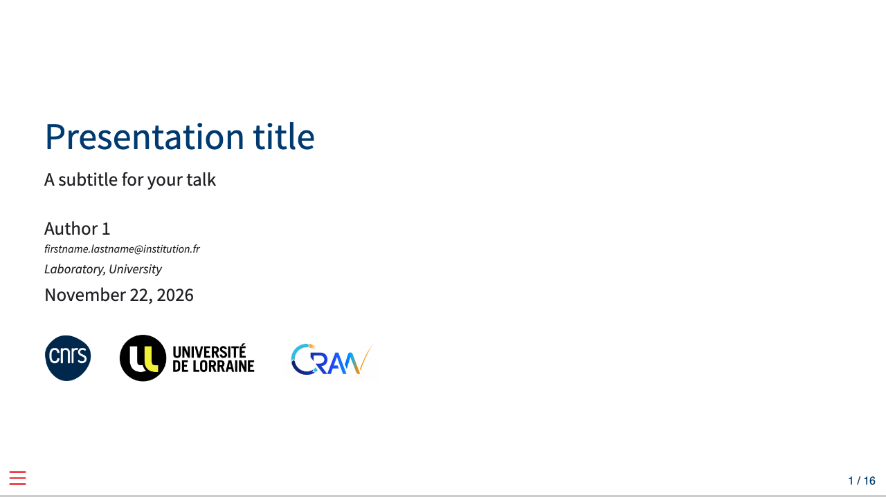
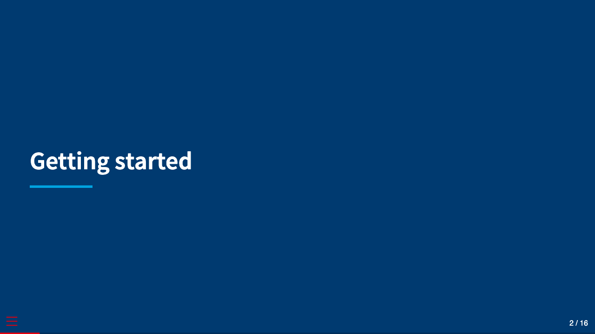
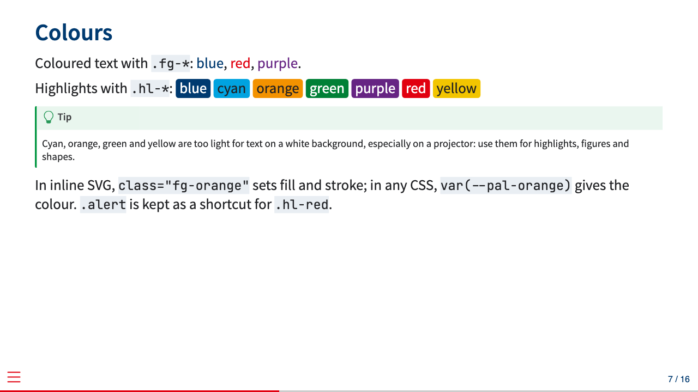
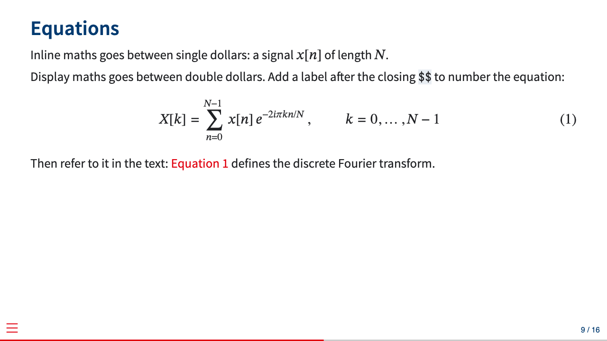

# Paillasse

A [Quarto](https://quarto.org) reveal.js template for research talks: 16:9 slides, section dividers, institution logos on the title slide, and a colour palette inspired by the CNRS visual identity.

*Paillasse* is French for a lab bench.

> **Unofficial.** Paillasse is not affiliated with or endorsed by the CNRS.

<p>
  
  
  
  
</p>

## Quick start

You need [Quarto](https://quarto.org/docs/get-started/) 1.4 or later (tested with 1.8).

**New presentation.** In an empty folder, run:

```sh
quarto use template jflamant/paillasse
```

This creates `<folder-name>.qmd` (an example deck to edit), a `logos/` folder and the `_extensions/paillasse/` extension.

**Replace the example logos.** The logos in `logos/` (CNRS, Université de Lorraine, CRAN) are those of the template's author. Put your own institutions' logos in that folder and list them under `title-logos` in the YAML header (see [Options](#options)).

Preview your slides with:

```sh
quarto preview <folder-name>.qmd
```

**Existing project.** Add the extension, then set the format in your document:

```sh
quarto add jflamant/paillasse
```

```yaml
format: paillasse-revealjs
```

## Options

Set these in the YAML header of your `.qmd` file:

| Option | What it does |
|---|---|
| `title-logos` | Logos on the title slide, left to right. Each item has a `src` (path) and an `alt` (description). |
| `logo` | Small logo in the bottom-right corner of content slides. Hidden on the title slide and on section dividers. With a logo, Quarto moves the slide number to the top right. |
| `footer` | Text at the bottom of every slide. |
| `section-divider` | `false` turns off coloured section dividers. |
| `section-divider-color` | Background colour of section dividers, for example `"#662483"`. |
| `lang` | `fr` for French dates and labels ("22 novembre 2026", "Astuce", "Avertissement"…). |

```yaml
title-logos:
  - src: logos/CNRS.png
    alt: CNRS
  - src: logos/my-university.png
    alt: My university
logo: logos/my-lab.png
footer: "Conference name, 2026"
lang: fr
```

All [Quarto reveal.js options](https://quarto.org/docs/reference/formats/presentations/revealjs.html) also work.

## Section dividers

Every `#` heading becomes a divider slide with a coloured background. `##` headings start ordinary slides.

To keep one `#` slide plain, write `# Title {.no-divider}`. A `#` heading with its own background, such as `{background-image="photo.jpg"}`, is left unchanged.

## Colours

| Name | Hex | Use for text on white? |
|---|---|---|
| blue | `#003a70` | yes (main colour) |
| red | `#e1000f` | yes (accent, links) |
| purple | `#662483` | yes |
| cyan | `#00a3e0` | no: highlights, figures, shapes |
| green | `#009640` | no: highlights, figures, shapes |
| orange | `#f39200` | no: highlights, figures, shapes |
| yellow | `#f2c500` | no: highlights, figures, shapes |

Cyan, green, orange and yellow are too light for text on a white background, especially on a projector.

In your slides:

- `[text]{.fg-blue}` colours text. On inline SVG elements, it also sets fill and stroke.
- `[text]{.hl-blue}` highlights text, with white or dark text chosen for readability. `.alert` is a shortcut for `.hl-red`.
- `var(--pal-blue)` gives the colour in any CSS.

**Figures in the same colours.** In Python (matplotlib):

```python
from cycler import cycler
import matplotlib.pyplot as plt

palette = ["#003a70", "#00a3e0", "#f39200", "#009640",
           "#662483", "#e1000f", "#f2c500"]
plt.rcParams["axes.prop_cycle"] = cycler(color=palette)
```

In R (ggplot2), use `scale_colour_manual(values = palette)` with the same list.

### Changing the colours

Create a file `custom.scss` next to your `.qmd`:

```scss
/*-- scss:defaults --*/
$pal-blue: #8b0000;   // headings, dividers and .fg-blue become dark red
```

and add it to the YAML header:

```yaml
format:
  paillasse-revealjs:
    theme: [custom.scss]
```

It is applied on top of the Paillasse theme. Variables you can change: `$pal-blue`, `$pal-red`, `$pal-cyan`, `$pal-green`, `$pal-orange`, `$pal-purple`, `$pal-yellow`, `$charcoal` (text), `$paper` (background), `$code-paper` (code background), `$divider-bg`, `$divider-accent`, and any [Quarto reveal.js Sass variable](https://quarto.org/docs/presentations/revealjs/themes.html#sass-variables).

## Fonts

Text uses Source Sans Pro, which ships with Quarto and works offline. Code uses JetBrains Mono from Google Fonts. Without internet, code falls back to Menlo or Consolas.

## PDF export

Open the slides in Chrome, Edge or another Chromium-based browser and press `E`: the slides switch to a print layout, one page per slide. Then print to PDF, with the margins set to **None** in the print dialog so that each slide fills its page. Press `E` again to return to the normal view.

## Credits and license

Paillasse is adapted from [soles-revealjs](https://github.com/usyd-soles-edu/soles-revealjs) by Januar Harianto. Both are licensed under [CC BY 4.0](https://creativecommons.org/licenses/by/4.0/); see [LICENSE](LICENSE).

If you share slides made with Paillasse, please keep a short credit, like the one on the last slide of the example deck.

The logos in `logos/` are trademarks of their institutions and are not covered by the license. Replace them with your own.
